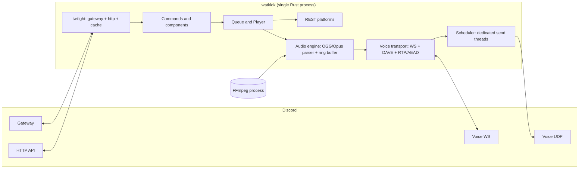

<div align="center">
  <h1>WatKLOK</h1>
  <p>
    English
    |
    <a href="./README_RU.md">Русский</a>
  </p>

  <p>
    <a href="">
      
    </a>
  </p>

  <p>
    <a href="LICENSE.md">
      
    </a>
    <a href="https://github.com/SNIPPIK/Untitles/releases/latest">
      
    </a>
    <a href="https://github.com/SNIPPIK/Untitles/releases">
      
    </a>
    <a href="https://github.com/SNIPPIK/Untitles/graphs/contributors">
      
    </a>
  </p>

  <p>
    <a href="https://discord.com/oauth2/authorize?client_id=623170593268957214"></a>
    <a href="https://discord.gg/qMf2Sv3"></a>
  </p>
</div>

---

> [!IMPORTANT]
> **WatKLOK (UnTitles)** is a fully open-source project developed and maintained by a single person. The release of fixes and new features depends on the author's available time.

> [!NOTE]
> WatKLOK is a **single native Rust binary**. It no longer requires Node.js, Bun, npm or N-API bindings. The only external runtime dependency is **FFmpeg**.

## 📑 Table of contents

- [Overview](#-overview)
- [Architecture](#-architecture)
- [Voice engine](#-voice-engine)
- [Platforms](#-platforms)
- [Audio](#-audio)
- [Commands](#-commands)
- [Getting started](#-getting-started)
- [Configuration](#-configuration)
- [Project layout](#-project-layout)
- [Shutdown](#-shutdown)
- [Logging](#-logging)
- [Feedback and authors](#-feedback-and-authors)

---

## ✨ Overview

A Discord music bot written entirely in **Rust** (edition 2024) on top of **tokio** and **twilight**.

* **One process, one language** — gateway, REST platforms, player, queue, voice transport and scheduler live in a single binary.
* **Own voice stack** — `WS` + `UDP` + `RTP` (AEAD AES-GCM) + `Opus`, with **End-to-End Encryption (E2EE 🔐)** through the **Discord DAVE** protocol.
* **Seven platforms** with automatic fallback between them.
* **Interactive player** — Components V2 messages, repeat modes, seek, volume, audio filters, hot audio swap.
* **Localization** — Russian and English.

---

## 🧩 Architecture



Data flow for one track:

1. A command (`/play`) asks the **REST layer** to resolve the query on the selected platform. All platforms are queried concurrently and results are taken in priority order.
2. The queue resolves a direct audio link (with a fallback to another platform if the track is unavailable) and starts **FFmpeg**.
3. FFmpeg writes **OGG/Opus**; the native parser slices it into Opus frames **without re-encoding**.
4. Frames go through a lock-free **ring buffer** to the **voice transport**, which wraps them into RTP, encrypts them (and applies DAVE E2EE when negotiated).
5. A **scheduler** with dedicated OS threads sends packets over UDP with precise 20 ms timing.

---

## 🦀 Voice engine

* **Transport** — custom implementation of Discord Voice: WebSocket control channel, UDP discovery, RTP with AEAD AES-GCM, heartbeat, resume and reconnect.
* **Security** — **DAVE** (E2EE) support via the `davey` crate.
* **Timing & Scheduler** — the sending cycle runs on dedicated worker threads with a high-precision clock and automatic balancing of voice sessions between workers. The scheduler measures how long sending takes and starts earlier by half of it, so packet departures are centered on the 20 ms frame grid instead of all landing after it. The RTP timeline is aligned to real time, so pauses, buffer underruns and track changes do not freeze the timestamp.
* **Opus** — Opus frames are parsed and forwarded without an external encoder at the sending stage.
* **FFmpeg** — used for decoding, stream conversion and complex audio filters. The order in which filters are applied may affect the result.
* **Isolation of the send path** — packet sending does not run on the tokio worker threads. A temporarily busy async runtime does not directly stall the UDP send loop, and the ring buffer absorbs short delays on the decoding side.

---

## 🌐 Platforms

**YouTube**, **Spotify**, **VK**, **Yandex Music**, **SoundCloud**, **Deezer**, **Apple Music** *(in development)* and internet **radio**.

* **Smart Fallback** — if a track is unavailable on one platform, an alternative source is found on another. Candidate links are verified before playback.
* **Related Tracks** — similar tracks are searched and added automatically (`/plaу wave`).
* **Concurrent requests** — platforms are queried in parallel; a slow low-priority platform does not delay the answer from a faster one.
* **Per-platform proxy** — every platform can be routed through a proxy independently (see [Configuration](#-configuration)).
* **Optional file cache** — downloaded tracks and metadata can be cached on disk, with de-duplication of concurrent downloads.
* **Extensibility** — platforms implement a common `Platform` trait, so a new one is added without touching the player.

> [!WARNING]
> When using a proxy, keep in mind that **FFmpeg** does not support the **SOCKS** protocol. HTTP requests of the bot itself can use SOCKS, but for FFmpeg use an HTTP proxy or **[STH](https://github.com/SNIPPIK/SHS)**.

---

## 🎵 [Audio](https://www.youtube.com/watch?v=CvwyNO9-4bM)

* **No artificial bitrate limit** — the pipeline does not limit the bitrate of the source; the real quality is limited by Discord and the codec.
* **Hot Audio Swap** — switching between audio streams without noticeable gaps.
* **Audio Effects** — smooth `fade-in` / `fade-out` on track switching, `skip`, `seek` and `pause` (`audio.fade`, `audio.swap.fade`).
* **Audio Filters** — built-in filters, extendable through the JSON file [`assets/filters.json`](assets/filters.json).
* **Synchronization** — the audio stream and its processing stay in sync when tracks are switched or filters are applied.
* **Error reporting** — playback and platform errors are reported in the text channel.

> [!WARNING]
> WatKLOK cannot guarantee that no packets will be lost after audio data is sent to Discord.
>
> Packet loss can occur anywhere between the bot, Discord servers and the client. UDP and Discord's network infrastructure make it impossible to eliminate completely. Losses that originate inside the bot's own pipeline are not hidden behind "network problems" — the playback state is shown in the current track message.

---

## 📚 Commands

<details>
<summary>Click to expand</summary>

| Command                | Autocomplete | Arguments                | Description                                  |
|:-----------------------|:------------:|:-------------------------|:---------------------------------------------|
| `/play`                |      ✅       | `query`                  | Play a track or search by query              |
| `/plaу search`         |      ✅       | `platform`, `request`    | Search and play on a specific platform       |
| `/plaу wave`           |      ✅       | `platform`, `request`    | Related tracks (endless playback mode)       |
| `/plaу radio`          |      ✅       | `station`                | Play an internet radio station               |
| `/skip`                |      ✅       | `to`, `back`, `next`     | Switch or skip tracks                        |
| `/repeat`              |      ❌       | `type`                   | Configure repeat mode                        |
| `/seek`                |      ❌       | `time`                   | Seek within the current track                |
| `/remove`              |      ✅       | `value`                  | Remove a track from the queue                |
| `/queue`               |      ✅       | `list`, `destroy`        | View or destroy the playback queue           |
| `/player`              |      ❌       | `replay`, `stop`, `volume` | Player controls                            |
| `/filter`              |      ✅       | `push`, `disable`, `off` | Manage audio filters                         |
| `/voice`               |      ❌       | `join`, `leave`, `tribune` | Manage the voice channel                   |
| `/status`              |      ❌       | —                        | View bot status                              |
| `/ping`                |      ❌       | —                        | Check latency                                |
| `/reload`              |      ❌       | —                        | Reload bot systems (developers only)         |

> [!NOTE]
> The command group is registered as `/plaу` with a **Cyrillic `у`** (`U+0443`). Discord does not allow a name to be both a command and a group of subcommands, so `/play` and `/plaу` are two different commands that look the same. Pick the group from the autocomplete list.

`/reload` is available only to users listed in `owner.list`.

</details>

---

## 🚀 Getting started

### Requirements

* **Rust** toolchain with edition 2024 support (Rust 1.85 or newer; a recent stable release is recommended) — only to build from source
* **FFmpeg**

### Build and run

```shell
# 1. Clone the repository
git clone https://github.com/SNIPPIK/UnTitles
cd UnTitles

# 2. Configure the environment
cp .env.custom .env
# Open .env and set token.discord (the only required parameter)

# 3. Build and run
cargo run --release
```

The binary is `target/release/watklok`. It reads `.env` from the **current working directory** and expects the `assets/` directory at build time (see [Project layout](#-project-layout)).

### FFmpeg

A system-wide FFmpeg installation is **not required**. The first working candidate wins:

1. `<cache.dir>/ffmpeg` and `<cache.dir>`
2. `ffmpeg.path` from `.env`
3. `build/native/ffmpeg` (`.exe` on Windows)
4. `ffmpeg` from `PATH`

If none of them works, the bot exits at startup with `FFmpeg not found`.

---

## 🛠 Configuration

Settings are read from the `.env` file. Keys may contain dots; booleans accept `on` / `true` and `off` / `false`.

| Key                                 | Default           | Description                                                       |
|:------------------------------------|:------------------|:------------------------------------------------------------------|
| `token.discord`                     | — (**required**)  | Discord bot token                                                 |
| `owner.list`                        | —                 | Comma-separated user IDs allowed to use developer commands        |
| `client.status`                     | `online`          | Bot status                                                        |
| `client.presence.array`             | —                 | JSON array of activities, e.g. `[{"name":"x","type":"Listening"}]` |
| `client.presence.array.update`      | `3600`            | Presence rotation interval                                        |
| `commands.cache`                    | `./commands.json` | Cache of registered application commands                          |
| `ffmpeg.path`                       | —                 | Path to FFmpeg                                                    |
| `decoder.type`                      | `audio`           | Opus `-application` mode passed to FFmpeg                         |
| `audio.volume`                      | `70`              | Default volume                                                    |
| `audio.fade`                        | `10`              | Fade length for skip / seek / pause                               |
| `audio.swap.fade`                   | `5`               | Fade length for hot audio swap                                    |
| `duration.optimization`             | `15`              | Margin (seconds) below which `seek` / fade-out are not applied    |
| `replay.type`                       | `1`               | `1` — replay from the last track, otherwise from the first        |
| `APIs.proxy`                        | —                 | HTTP(S)/SOCKS proxy for platform requests                         |
| `APIs.ffmpeg.proxy`                 | `APIs.proxy`      | Proxy for FFmpeg (HTTP only, no SOCKS)                            |
| `<platform>.proxy`                  | `false`           | Route a platform through the proxy: `youtube`, `spotify`, `vk`, `yandex`, `soundcloud`, `deezer`, `apple_music` |
| `vk.token`, `yandex.token`, `apple_music.token` | —     | Platform access tokens                                            |
| `cache`                             | `false`           | Enable the file cache                                             |
| `cache.dir`                         | `./cache`         | Cache directory                                                   |
| `cache.file`                        | `false`           | Also cache track metadata                                         |
| `cache.downloads`                   | `2`               | Maximum number of simultaneous cache downloads                    |
| `image.banner`, `image.currentPlay`, `image.not` | —    | Image URLs for the player message                                 |
| `loading.emoji`, `disk.emoji`, `user.emoji`, `queue.emoji`, `selected.emoji` | — | Emoji used in messages and buttons |
| `progress.*`                        | —                 | Glyphs of the progress bar                                        |

---

## 🗂 Project layout

```text
.
├── Cargo.toml
├── assets/                  # embedded at build time (include_str!)
│   ├── languages.json       #   localization (en-US is the default)
│   ├── filters.json         #   audio filters
│   └── stations.json        #   radio stations
└── src/
    ├── main.rs              # entry point: logger -> locale -> .env -> FFmpeg -> gateway
    ├── config.rs            # .env parser
    ├── locale.rs            # localization
    ├── discord/             # gateway, REST helpers, commands, components, voice
    │   ├── api/             #   gateway / HTTP (per-route rate limits) / interaction context
    │   ├── handlers/        #   commands, components, middlewares
    │   └── voice/           #   voice transport (WS, UDP, DAVE)
    ├── core/
    │   ├── player/          # player, playback cycle, filters
    │   ├── queue/           # queue, tracks, track resolving
    │   ├── rest/            # platforms and fallback logic
    │   ├── audio/           # FFmpeg process and audio resource
    │   ├── cache.rs         # file cache
    │   ├── events.rs        # player events -> Discord messages
    │   └── ui.rs            # embeds and Components V2
    └── structures/
        ├── audio/           # OGG/Opus parser, engine, ring buffer
        ├── crypto/          # RTP + AES-GCM
        ├── network/         # WebSocket and UDP
        └── timers/          # high-precision scheduler
```

> [!NOTE]
> The `assets/` directory must exist when compiling: all three files are embedded into the binary.

---

## 🛑 Shutdown

The bot stops gracefully on `SIGINT` (Ctrl+C), `SIGTERM`, `SIGHUP` and `SIGQUIT` (Unix), and on Ctrl+C, Ctrl+Break, console close, logoff and system shutdown (Windows):

1. all queues are destroyed — including paused and idle ones — which stops the players and their FFmpeg processes;
2. leftover voice connections are closed and the bot leaves the voice channels;
3. player messages with dead buttons are deleted from text channels;
4. gateway shards are closed cleanly.

A **second signal** or a **25 second deadline** forces an immediate exit, so a stuck shutdown can always be interrupted.

---

## 📝 Logging

Logging uses `tracing`. The level is controlled by the standard `RUST_LOG` variable.

```shell
RUST_LOG=info,watklok=debug cargo run --release
```

Without `RUST_LOG`, release builds log at `info` and debug builds at `info,watklok=debug`.

---

## 👥 Feedback and authors

The project is developed and maintained by a single author.

* 👤 **[SNIPPIK](https://github.com/SNIPPIK)**

If you find a bug, encounter unexpected behavior, or have an idea for an improvement — please open an **Issue** or join the **Discord server**.

* 🐞 **Issues:** https://github.com/SNIPPIK/Untitles/issues
* 💬 **Discord:** https://discord.gg/qMf2Sv3
