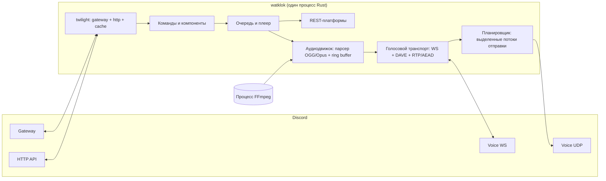

<div align="center">
  <h1>WatKLOK</h1>
  <p>
    <a href="./README.md">English</a>
    |
    Русский
  </p>

  <p>
    <a href="">
      
    </a>
  </p>

  <p>
    <a href="LICENSE.md">
      
    </a>
    <a href="https://github.com/SNIPPIK/Untitles/releases/latest">
      
    </a>
    <a href="https://github.com/SNIPPIK/Untitles/releases">
      
    </a>
    <a href="https://github.com/SNIPPIK/Untitles/graphs/contributors">
      
    </a>
  </p>

  <p>
    <a href="https://discord.com/oauth2/authorize?client_id=623170593268957214"></a>
    <a href="https://discord.gg/qMf2Sv3"></a>
  </p>
</div>

---

> [!IMPORTANT]
> **WatKLOK (UnTitles)** — полностью открытый проект, который разрабатывается и поддерживается одним человеком. Выпуск исправлений и новых возможностей зависит от свободного времени автора.

> [!NOTE]
> WatKLOK — **единый нативный Rust-бинарник**. Node.js, Bun, npm и N-API-биндинги больше не нужны. Единственная внешняя зависимость времени выполнения — **FFmpeg**.

## 📑 Содержание

- [Обзор](#-обзор)
- [Архитектура](#-архитектура)
- [Голосовой движок](#-голосовой-движок)
- [Платформы](#-платформы)
- [Звук](#-звук)
- [Команды](#-команды)
- [Запуск](#-запуск)
- [Конфигурация](#-конфигурация)
- [Структура проекта](#-структура-проекта)
- [Остановка](#-остановка)
- [Логирование](#-логирование)
- [Обратная связь и авторы](#-обратная-связь-и-авторы)

---

## ✨ Обзор

Музыкальный Discord-бот, полностью написанный на **Rust** (edition 2024) поверх **tokio** и **twilight**.

* **Один процесс, один язык** — gateway, REST-платформы, плеер, очередь, голосовой транспорт и планировщик находятся в одном бинарнике.
* **Собственный голосовой стек** — `WS` + `UDP` + `RTP` (AEAD AES-GCM) + `Opus`, со сквозным шифрованием **End-to-End Encryption (E2EE 🔐)** через протокол **Discord DAVE**.
* **Семь платформ** с автоматическим переключением между ними.
* **Интерактивный плеер** — сообщения Components V2, повтор, перемотка, громкость, аудиофильтры, Hot Audio Swap.
* **Локализация** — русский и английский языки.

---

## 🧩 Архитектура



Путь одного трека:

1. Команда (`/play`) просит **REST-слой** найти запрос на выбранной платформе. Все платформы опрашиваются параллельно, результаты берутся в порядке приоритета.
2. Очередь получает прямую ссылку на аудио (при недоступности трека — с переключением на другую платформу) и запускает **FFmpeg**.
3. FFmpeg пишет **OGG/Opus**; нативный парсер нарезает его на Opus-кадры **без перекодирования**.
4. Кадры через lock-free **ring buffer** попадают в **голосовой транспорт**: оборачиваются в RTP и шифруются (с E2EE DAVE, если оно согласовано).
5. **Планировщик** на выделенных потоках ОС отправляет пакеты по UDP с точным интервалом 20 мс.

---

## 🦀 Голосовой движок

* **Транспорт** — собственная реализация Discord Voice: управляющий WebSocket, UDP discovery, RTP с AEAD AES-GCM, heartbeat, resume и переподключение.
* **Безопасность** — поддержка **DAVE** (E2EE) через крейт `davey`.
* **Тайминг и планировщик** — цикл отправки работает на выделенных рабочих потоках с высокоточными часами и автоматическим распределением голосовых сессий между ними. Планировщик измеряет длительность отправки и начинает её раньше на половину этого времени, поэтому вылет пакетов центрируется вокруг сетки кадров 20 мс, а не целиком приходится после неё. Таймлайн RTP выравнивается по реальному времени, поэтому паузы, опустошение буфера и смена трека не «замораживают» timestamp.
* **Opus** — Opus-кадры разбираются и передаются без внешнего кодировщика на этапе отправки.
* **FFmpeg** — используется для декодирования, преобразования потока и сложных аудиофильтров. Порядок применения фильтров может влиять на итоговый результат.
* **Изоляция пути отправки** — отправка пакетов не выполняется на рабочих потоках tokio. Временно занятый async-рантайм напрямую не останавливает UDP-цикл, а ring buffer сглаживает короткие задержки на стороне декодирования.

---

## 🌐 Платформы

**YouTube**, **Spotify**, **VK**, **Yandex Music**, **SoundCloud**, **Deezer**, **Apple Music** *(в разработке)* и интернет-**радио**.

* **Умный Fallback** — если трек недоступен на одной платформе, альтернативный источник ищется на другой. Ссылки кандидатов проверяются перед воспроизведением.
* **Related Tracks** — автоматический поиск и добавление похожих треков (`/plaу wave`).
* **Параллельные запросы** — платформы опрашиваются одновременно; медленная платформа с низким приоритетом не задерживает ответ более быстрой.
* **Прокси для каждой платформы** — любая платформа может ходить через прокси независимо от остальных (см. [Конфигурацию](#-конфигурация)).
* **Опциональный файловый кэш** — скачанные треки и метаданные можно кэшировать на диск, одновременные загрузки одного файла объединяются.
* **Расширяемость** — платформы реализуют общий трейт `Platform`, поэтому новую можно добавить без изменения плеера.

> [!WARNING]
> При использовании прокси учитывайте, что **FFmpeg** не поддерживает протокол **SOCKS**. Собственные HTTP-запросы бота могут идти через SOCKS, но для FFmpeg используйте HTTP-прокси или **[STH](https://github.com/SNIPPIK/SHS)**.

---

## 🎵 [Звук](https://www.youtube.com/watch?v=CvwyNO9-4bM)

* **Без искусственных ограничений битрейта** — пайплайн не ограничивает битрейт источника; фактическое качество ограничено Discord и кодеком.
* **Hot Audio Swap** — переключение между аудиопотоками без заметных разрывов.
* **Audio Effects** — плавный `fade-in` / `fade-out` при переключении треков, `skip`, `seek` и `pause` (`audio.fade`, `audio.swap.fade`).
* **Аудиофильтры** — встроенные фильтры, расширяемые через JSON-файл [`assets/filters.json`](assets/filters.json).
* **Синхронизация** — аудиопоток и его обработка остаются синхронными при смене треков и применении фильтров.
* **Сообщения об ошибках** — ошибки воспроизведения и платформ выводятся в текстовый канал.

> [!WARNING]
> WatKLOK не может гарантировать отсутствие потерь пакетов после отправки аудиоданных в Discord.
>
> Потери могут возникать на любом участке между ботом, серверами Discord и клиентом. Из-за особенностей UDP и сетевой инфраструктуры Discord полностью исключить их невозможно. Потери, возникающие внутри аудиопайплайна бота, не маскируются под сетевые проблемы — состояние воспроизведения отображается в сообщении текущего трека.

---

## 📚 Команды

<details>
<summary>Нажми, чтобы открыть</summary>

| Команда        | Autocomplete | Аргументы                  | Описание                                     |
|:---------------|:------------:|:---------------------------|:---------------------------------------------|
| `/play`        |      ✅       | `query`                    | Воспроизведение трека или поиск по запросу   |
| `/plaу search` |      ✅       | `platform`, `request`      | Поиск и воспроизведение на выбранной платформе |
| `/plaу wave`   |      ✅       | `platform`, `request`      | Похожие треки (режим бесконечного воспроизведения) |
| `/plaу radio`  |      ✅       | `station`                  | Воспроизведение интернет-радио               |
| `/skip`        |      ✅       | `to`, `back`, `next`       | Переключение и пропуск треков                |
| `/repeat`      |      ❌       | `type`                     | Настройка режима повтора                     |
| `/seek`        |      ❌       | `time`                     | Перемотка текущего трека                     |
| `/remove`      |      ✅       | `value`                    | Удаление трека из очереди                    |
| `/queue`       |      ✅       | `list`, `destroy`          | Просмотр и уничтожение очереди               |
| `/player`      |      ❌       | `replay`, `stop`, `volume` | Управление плеером                           |
| `/filter`      |      ✅       | `push`, `disable`, `off`   | Управление аудиофильтрами                    |
| `/voice`       |      ❌       | `join`, `leave`, `tribune` | Управление голосовым каналом                 |
| `/status`      |      ❌       | —                          | Состояние бота                               |
| `/ping`        |      ❌       | —                          | Проверка задержки                            |
| `/reload`      |      ❌       | —                          | Перезагрузка систем бота (только разработчики) |

> [!NOTE]
> Группа команд зарегистрирована как `/plaу` с **кириллической `у`** (`U+0443`). Discord не позволяет одному имени быть одновременно командой и группой подкоманд, поэтому `/play` и `/plaу` — две разные команды, которые выглядят одинаково. Выбирайте группу из списка автодополнения.

`/reload` доступна только пользователям из `owner.list`.

</details>

---

## 🚀 Запуск

### Требования

* Тулчейн **Rust** с поддержкой edition 2024 (Rust 1.85 или новее; рекомендуется свежий stable) — только для сборки из исходников
* **FFmpeg**

### Сборка и запуск

```shell
# 1. Клонируем репозиторий
git clone https://github.com/SNIPPIK/UnTitles
cd UnTitles

# 2. Настраиваем окружение
cp .env.custom .env
# Откройте .env и укажите token.discord (единственный обязательный параметр)

# 3. Собираем и запускаем
cargo run --release
```

Бинарник — `target/release/watklok`. Он читает `.env` из **текущей рабочей директории**, а каталог `assets/` должен существовать на этапе сборки (см. [Структуру проекта](#-структура-проекта)).

### FFmpeg

Устанавливать FFmpeg в систему **не обязательно**. Используется первый рабочий кандидат:

1. `<cache.dir>/ffmpeg` и `<cache.dir>`
2. `ffmpeg.path` из `.env`
3. `build/native/ffmpeg` (`.exe` на Windows)
4. `ffmpeg` из `PATH`

Если ни один не подходит, бот завершится при старте с ошибкой `FFmpeg not found`.

---

## 🛠 Конфигурация

Настройки читаются из файла `.env`. Ключи могут содержать точки; булевы значения принимают `on` / `true` и `off` / `false`.

| Ключ                                | По умолчанию      | Описание                                                          |
|:------------------------------------|:------------------|:------------------------------------------------------------------|
| `token.discord`                     | — (**обязателен**) | Токен Discord-бота                                               |
| `owner.list`                        | —                 | ID пользователей через запятую, которым доступны команды разработчика |
| `client.status`                     | `online`          | Статус бота                                                       |
| `client.presence.array`             | —                 | JSON-массив активностей, например `[{"name":"x","type":"Listening"}]` |
| `client.presence.array.update`      | `3600`            | Интервал смены активности                                         |
| `commands.cache`                    | `./commands.json` | Кэш зарегистрированных команд приложения                          |
| `ffmpeg.path`                       | —                 | Путь к FFmpeg                                                     |
| `decoder.type`                      | `audio`           | Режим Opus `-application`, передаваемый в FFmpeg                  |
| `audio.volume`                      | `70`              | Громкость по умолчанию                                            |
| `audio.fade`                        | `10`              | Длительность fade при skip / seek / pause                         |
| `audio.swap.fade`                   | `5`               | Длительность fade при Hot Audio Swap                              |
| `duration.optimization`             | `15`              | Запас (секунды), ниже которого `seek` / fade-out не применяются   |
| `replay.type`                       | `1`               | `1` — повтор с последнего трека, иначе с первого                  |
| `APIs.proxy`                        | —                 | HTTP(S)/SOCKS-прокси для запросов к платформам                    |
| `APIs.ffmpeg.proxy`                 | `APIs.proxy`      | Прокси для FFmpeg (только HTTP, без SOCKS)                        |
| `<platform>.proxy`                  | `false`           | Направить платформу через прокси: `youtube`, `spotify`, `vk`, `yandex`, `soundcloud`, `deezer`, `apple_music` |
| `vk.token`, `yandex.token`, `apple_music.token` | —     | Токены доступа к платформам                                       |
| `cache`                             | `false`           | Включить файловый кэш                                             |
| `cache.dir`                         | `./cache`         | Каталог кэша                                                      |
| `cache.file`                        | `false`           | Кэшировать также метаданные треков                                |
| `cache.downloads`                   | `2`               | Максимум одновременных загрузок в кэш                             |
| `image.banner`, `image.currentPlay`, `image.not` | —    | URL картинок сообщения плеера                                     |
| `loading.emoji`, `disk.emoji`, `user.emoji`, `queue.emoji`, `selected.emoji` | — | Эмодзи в сообщениях и кнопках |
| `progress.*`                        | —                 | Символы прогресс-бара                                             |

---

## 🗂 Структура проекта

```text
.
├── Cargo.toml
├── assets/                  # встраивается при сборке (include_str!)
│   ├── languages.json       #   локализация (по умолчанию en-US)
│   ├── filters.json         #   аудиофильтры
│   └── stations.json        #   радиостанции
└── src/
    ├── main.rs              # точка входа: логгер -> локаль -> .env -> FFmpeg -> gateway
    ├── config.rs            # парсер .env
    ├── locale.rs            # локализация
    ├── discord/             # gateway, REST-хелперы, команды, компоненты, голос
    │   ├── api/             #   gateway / HTTP (лимиты по маршрутам) / контекст interaction
    │   ├── handlers/        #   команды, компоненты, middleware
    │   └── voice/           #   голосовой транспорт (WS, UDP, DAVE)
    ├── core/
    │   ├── player/          # плеер, цикл воспроизведения, фильтры
    │   ├── queue/           # очередь, треки, резолв треков
    │   ├── rest/            # платформы и логика fallback
    │   ├── audio/           # процесс FFmpeg и аудиоресурс
    │   ├── cache.rs         # файловый кэш
    │   ├── events.rs        # события плеера -> сообщения Discord
    │   └── ui.rs            # embed и Components V2
    └── structures/
        ├── audio/           # парсер OGG/Opus, движок, ring buffer
        ├── crypto/          # RTP + AES-GCM
        ├── network/         # WebSocket и UDP
        └── timers/          # высокоточный планировщик
```

> [!NOTE]
> Каталог `assets/` должен существовать при компиляции: все три файла встраиваются в бинарник.

---

## 🛑 Остановка

Бот корректно завершается по `SIGINT` (Ctrl+C), `SIGTERM`, `SIGHUP` и `SIGQUIT` (Unix), а на Windows — по Ctrl+C, Ctrl+Break, закрытию консоли, выходу из системы и выключению:

1. уничтожаются все очереди — в том числе на паузе и в простое: останавливаются плееры и их процессы FFmpeg;
2. закрываются оставшиеся голосовые подключения, бот выходит из голосовых каналов;
3. сообщения плеера с мёртвыми кнопками удаляются из текстовых каналов;
4. шарды gateway закрываются штатно.

**Второй сигнал** или **дедлайн 25 секунд** — немедленный выход: зависшую остановку всегда можно прервать.

---

## 📝 Логирование

Логирование построено на `tracing`. Уровень задаётся стандартной переменной `RUST_LOG`.

```shell
RUST_LOG=info,watklok=debug cargo run --release
```

Без `RUST_LOG` release-сборка пишет логи уровня `info`, debug-сборка — `info,watklok=debug`.

---

## 👥 Обратная связь и авторы

Проект разрабатывается и поддерживается одним автором.

* 👤 **[SNIPPIK](https://github.com/SNIPPIK)**

Если вы нашли ошибку, столкнулись с неожиданным поведением или хотите предложить улучшение — создайте **Issue** или присоединяйтесь к **Discord-серверу**.

* 🐞 **Issues:** https://github.com/SNIPPIK/Untitles/issues
* 💬 **Discord:** https://discord.gg/qMf2Sv3
